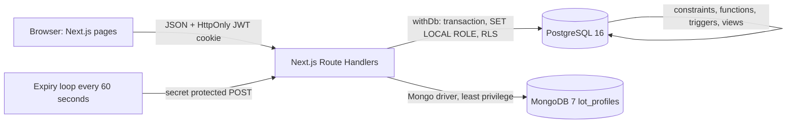

# Architecture

Booking path: browser submits a time window and selected slot; the API validates the body and role; `withDb` establishes the caller identity; `sp_create_booking` computes the price and creates the hold; the temporal exclusion constraint rejects overlap; the response includes booking code and expiry; payment simulation updates a payment row and a trigger confirms the booking.

Authorization layers: JWT/path check in edge middleware; `requireRole` or API session check in route handlers; fixed PostgreSQL role mapping and RLS in the database. Admin scripts connect with admin credentials and are not imported by the application server.
